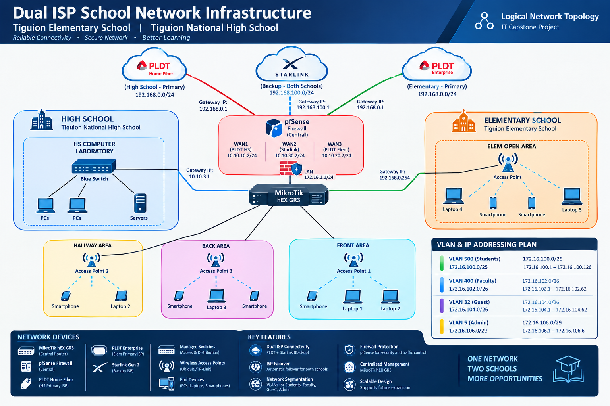

# Dual ISP School Network Infrastructure

A comprehensive logical network design and portfolio showcase designed for **Tiguion National High School** and **Tiguion Elementary School**.



---

## 📌 Project Overview

This project presents a resilient, secure, and scalable dual-ISP network architecture serving two educational institutions. The design ensures uninterrupted connectivity for computer laboratories, faculty, administrative staff, and guest users across both campuses.

### Key Highlights
- **Primary Connection (High School):** PLDT Home Fiber
- **Primary Connection (Elementary School):** PLDT Enterprise
- **Shared Backup:** Starlink Satellite Internet
- **Central Firewall & Router:** pfSense Firewall + MikroTik hEX GR3 Router
- **Network Segmentation:** 4 Dedicated VLANs with tailored subnet allocations

---

## 🛠️ Network Architecture & Specifications

### 1. Dual ISP & Automatic Failover
- **pfSense Firewall** operates as the central security edge, handling WAN traffic from PLDT Home Fiber, PLDT Enterprise, and Starlink.
- Configured multi-WAN failover ensures that if primary ISPs drop, traffic automatically reroutes through Starlink to maintain zero disruption to school operations.

### 2. MikroTik Routing & Switching
- A **MikroTik hEX GR3** handles internal LAN routing (`172.16.1.1/24`), distribution across managed switches, and VLAN trunking to APs.

### 3. VLAN & IP Addressing Plan

| VLAN | Target Audience | Network CIDR | Gateway IP | IP Range |
| :--- | :--- | :--- | :--- | :--- |
| **VLAN 500** | Students | `172.16.100.0/25` | `172.16.100.1` | `172.16.100.1` – `172.16.100.126` |
| **VLAN 400** | Faculty | `172.16.102.0/26` | `172.16.102.1` | `172.16.102.1` – `172.16.102.62` |
| **VLAN 32** | Guest | `172.16.104.0/26` | `172.16.104.1` | `172.16.104.1` – `172.16.104.62` |
| **VLAN 5** | Admin | `172.16.106.0/29` | `172.16.106.1` | `172.16.106.1` – `172.16.106.6` |

---

## 📁 Repository Structure

```text
├── index.html        # Single-page web portfolio showcasing the network topology
├── dual-isp.png      # High-resolution network diagram image
└── README.md         # Documentation & project summary
```

---

## 🌐 Live Preview / GitHub Pages Setup

To view the interactive single-page website:

1. Upload `index.html`, `dual-isp.png`, and `README.md` to your GitHub repository.
2. Go to **Settings** > **Pages** in your GitHub repository.
3. Under **Build and deployment** > **Branch**, select `main` (or `master`) and click **Save**.
4. Your portfolio will be live at `https://<your-username>.github.io/<repository-name>/`.

---

## 👤 Author

- **Fritz Jenner Vitto**
- **LinkedIn:** [Fritz Jenner Vitto](https://www.linkedin.com/in/fritz-jenner-vitto-948030416/)